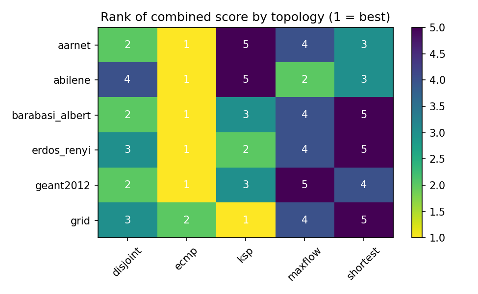

# multipath-eval

A toolkit that compares multipath routing algorithms on generated and real network topologies.

## What I did
- Implemented five routing algorithms:

| name | idea |
|---|---|
| `shortest` | one least-cost path |
| `ksp` | k least-cost loopless paths (Yen), equal split |
| `disjoint` | up to k edge-disjoint paths, equal split |
| `ecmp` | all least-hop paths (up to k), equal split |
| `maxflow` | maximum flow decomposed into paths, split by path flow |

- Scored each one on **cost, delay, capacity and outage probability** (Monte Carlo with independent link failures), and combined the four into one normalised score.
- Added comparisons beyond one score: Pareto non-dominance, how often each algorithm wins under random weights, and Kendall's tau between rankings of different scenarios.
- Ran everything on Erdos-Renyi, grid and Barabasi-Albert graphs (5 seeds each) and on three Internet Topology Zoo networks (Abilene, Aarnet, Geant2012).

## Results
750 source-destination pairs in 90 scenarios (30 topologies x 3 failure settings).

| algorithm | mean combined score | ranks first | first under random weights | outage prob. | capacity |
|---|---|---|---|---|---|
| ecmp | 0.610 | 87.8% | 41.9% | 0.061 | 3.82 |
| disjoint | 0.528 | 0.0% | 7.0% | 0.031 | 4.21 |
| ksp | 0.497 | 12.2% | 10.7% | 0.033 | 3.70 |
| maxflow | 0.480 | 0.0% | 28.1% | 0.029 | 10.06 |
| shortest | 0.469 | 0.0% | 12.4% | 0.099 | 3.27 |

- With equal weights ECMP ranks first in 88% of scenarios, but only 42% of random weight vectors. Max-flow wins 28% of them because it carries about 2.4 times the capacity of the next algorithm.
- Rankings across scenarios agree moderately: mean Kendall tau 0.43 over 4005 scenario pairs.




Full tables: [results/default/results.md](results/default/results.md).

## How it was built

```
config (topologies, seeds, k, weights) -> build graphs -> run 5 algorithms
   -> metrics (cost, delay, capacity, outage) -> combined score -> rankings + plots
```

Everything is set in `configs/default.toml`, and the same config always gives the same output files. The design is in [docs/BLUEPRINT.md](docs/BLUEPRINT.md).

## Tech stack
Python, NumPy, NetworkX, SciPy, pandas, Matplotlib, pytest.

## Data
Internet Topology Zoo (Knight et al., IEEE JSAC 2011), CC BY.
