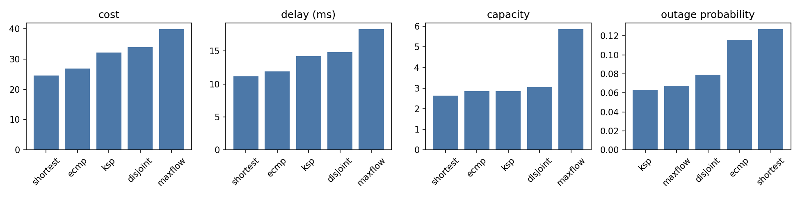
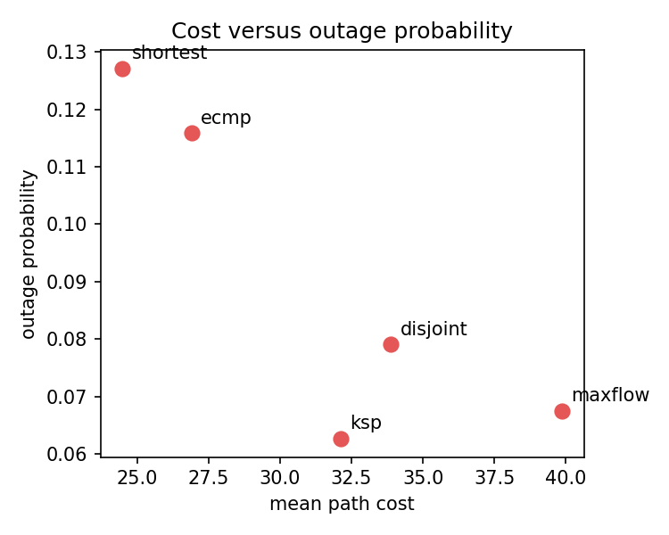
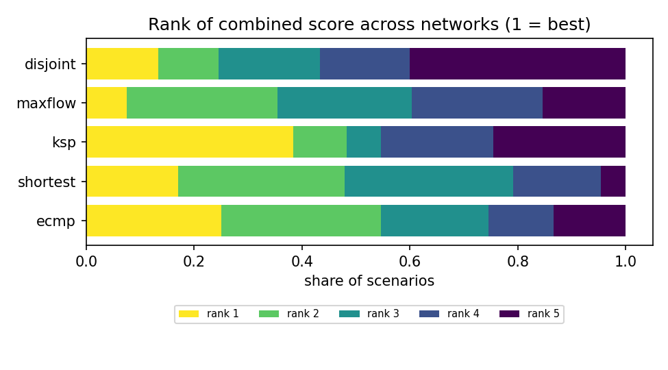

# multipath-eval

A toolkit that compares multipath routing algorithms on 80 real operator networks.

## What I did
- Implemented five routing algorithms:

| name | idea |
|---|---|
| `shortest` | one least-cost path |
| `ksp` | k least-cost loopless paths (Yen), equal split |
| `disjoint` | up to k edge-disjoint paths, equal split |
| `ecmp` | all least-hop paths (up to k), equal split |
| `maxflow` | maximum flow decomposed into paths, split by path flow |

- Scored each one on **cost, delay, capacity and outage probability** (Monte Carlo with 4,000 draws), and combined the four into one normalised score.
- Added comparisons beyond one score: Pareto non-dominance, how often each algorithm wins under random weights, and Kendall's tau between rankings of different scenarios.
- Ran everything on 80 networks from the Internet Topology Zoo (at least 15 nodes), with 25 random source-destination pairs each and three failure settings (x0.5, x1, x2): 240 scenarios, 2,000 demands. Delay comes from real link lengths; link speeds are real where the file has them.
- **v2:** added five more algorithms, and a second failure model where nearby links fail together (a regional event knocks out every link within 30 to 150 km of a random point), with the same average failure rate as the independent model.

| v2 algorithm | idea |
|---|---|
| `mincost_maxflow` | among all maximum flows, the cheapest |
| `disjoint_mincost` | the k edge-disjoint paths of least total cost |
| `ksp_wcmp` | k shortest paths, split in proportion to bottleneck capacity |
| `node_disjoint` | k node-disjoint paths |
| `geo_diverse` | paths that avoid the neighbourhood (150 km) of the earlier ones |

## Results
Original five algorithms, 240 scenarios:

| algorithm | cost | delay (ms) | capacity | outage prob. | combined score | first (equal weights) | first (random weights) |
|---|---:|---:|---:|---:|---:|---:|---:|
| shortest | 24.5 | 11.2 | 2.6 | 0.127 | 0.508 | 17% | 30% |
| ecmp | 26.9 | 11.9 | 2.9 | 0.116 | 0.507 | 25% | 11% |
| ksp | 32.1 | 14.2 | 2.9 | 0.063 | 0.492 | **38%** | 23% |
| maxflow | 39.9 | 18.3 | **5.9** | 0.068 | 0.490 | 8% | 28% |
| disjoint | 33.9 | 14.8 | 3.1 | 0.079 | 0.452 | 13% | 9% |

- `ksp` is first most often with equal weights, but `shortest` and `maxflow` lead across random weight vectors. `maxflow` carries 1.9 times the capacity of the next algorithm for a cost 63% above `shortest`.
- Rankings across scenarios agree weakly: mean Kendall tau 0.05.

**v2 (10 algorithms, 95% interval by resampling networks):**
- `mincost_maxflow` carries the same traffic as `maxflow` at **18% lower cost** (-7.1, -9.2 to -5.6) and with lower outage. It is first by combined score in **89%** of scenarios (91% under regional failures) and in 52% of random weight vectors.
- `ksp_wcmp` gives **25% more capacity** than `ksp` (+0.70, +0.59 to +0.81) at lower cost.
- `disjoint_mincost` is cheaper than `disjoint` (-1.8) with lower outage (-0.004).
- The best algorithm is the same under independent and regional failures in 89% of scenarios.







Full tables: [results/default/results.md](results/default/results.md) (original five) and [results/v2/results_v2.md](results/v2/results_v2.md). More detail in [docs/V2.md](docs/V2.md).

## How it was built

```
config (80 networks, k, weights) -> load graphs -> run 10 algorithms
   -> metrics under 2 failure models (cost, delay, capacity, outage) -> combined score -> rankings + plots
```

Everything is set in `configs/default.toml`, and the same config always gives the same output files. The design is in [docs/BLUEPRINT.md](docs/BLUEPRINT.md). 18 tests.

## Tech stack
Python, NumPy, NetworkX, SciPy, pandas, scikit-learn, Matplotlib, pytest.

## Data
Internet Topology Zoo (Knight et al., IEEE JSAC 2011), CC BY.
