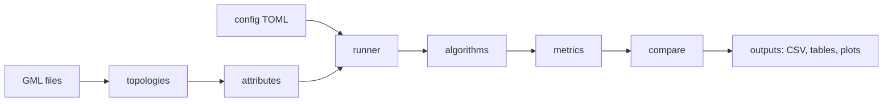

# multipath-eval: Blueprint

Research toolkit that implements selected multipath routing algorithms, runs them on real operator network topologies (Internet Topology Zoo), scores them on cost, delay, capacity and fault probability, adds one combined cross-property comparison, and checks whether the rankings stay consistent across networks and settings.

**Collapsed sections (research repo, no users, no network service):** actors, API design, event architecture, frontend, background jobs, authn/authz, threat model, deployment. There is no server, no database, no LLM and no ML model. Reason: the tool is a batch command-line program that reads a config file and writes tables and plots. Dependency security is covered by pinned versions in `pyproject.toml`.

## 1. Executive summary
- **Problem:** routing papers usually rank algorithms on one property at a time, on one network. A thesis needs a comparison across cost, delay, capacity and fault probability, and a check that the answer does not flip on another topology or setting.
- **Users:** one researcher running experiments from a terminal.
- **How it works:** config (TOML) -> topology generators or GML loader -> edge attribute assignment (seeded) -> routing algorithms -> per-demand metrics -> cross-property comparison and rank-consistency analysis -> CSV, Markdown tables, PNG plots.
- **Key challenges:** defining capacity and fault probability for a *split* path set in a way that is fair across algorithms; combining properties on different scales without hiding trade-offs; making every number reproducible.

## 2. Requirements
| # | Requirement | Priority |
|---|---|---|
| F1 | Load Topology Zoo GML files; derive delay from node coordinates, capacity from link speed where present | must |
| F2 | Assign edge cost, delay, capacity, fault probability from configured distributions, seeded; use real values from GML (link speed, coordinates) when present | must |
| F3 | Algorithms: single shortest path (baseline), k-shortest paths, edge-disjoint paths, ECMP, max-flow split | must |
| F4 | Metrics per demand: cost, delay, capacity, outage probability, expected loss | must |
| F5 | Combined score with configurable weights, plus Pareto dominance and rank-stability under random weights | must |
| F6 | Consistency analysis: Kendall's tau between rankings across topologies and settings, win-rate matrix | must |
| F7 | Output CSV, Markdown tables, PNG plots to a run directory | must |
| N1 | Reproducible: all randomness from seeds in the config; same config gives same files | must |
| N2 | A full default run finishes in minutes on a laptop | should |
| N3 | Typed, tested, no hardcoded parameters | must |

## 3. Architecture

Modules: `config`, `topologies`, `attributes`, `algorithms`, `metrics`, `compare`, `report`, `cli`. Each does one job and has no knowledge of the CLI.

## 4. Data model (in-memory, plain dataclasses)
| Entity | Fields |
|---|---|
| EdgeAttrs | cost (float > 0), delay_ms (float > 0), capacity (float > 0), fail_prob (float in [0,1)) |
| RoutingResult | paths: list of node lists, split: list of fractions summing to 1 |
| Scenario | topology name, seed, setting name (fail_scale, demand count) |
| MetricRow | scenario, algorithm, src, dst, cost, delay_ms, capacity, outage_prob, expected_loss |

## 5. Algorithms and metrics (the core logic)
- **Baseline `shortest`:** one least-cost path. Complexity O(E log V).
- **`ksp`:** first k loopless paths by cost (Yen), equal split. O(k V (E + V log V)).
- **`disjoint`:** up to k edge-disjoint paths (max-flow based, networkx), equal split.
- **`ecmp`:** all least-hop-count paths (capped at k), equal split. Hop count is used as the metric because equal-cost ties do not occur with continuous costs.
- **`maxflow`:** maximum flow on edge capacities, decomposed into paths; split proportional to the flow on each path. Infeasible when src and dst are disconnected (those demands are skipped and counted).
- **cost** = sum over paths of split x path cost. **delay** = split-weighted mean path delay.
- **capacity** = largest demand rate the split can carry: min over edges of capacity_e / (sum of split over paths using e).
- **outage probability** = probability that every path fails, edges failing independently with fail_prob (Monte Carlo, seeded, n draws from config). **expected loss** = sum of split x path failure probability (exact).
- **Combined score:** per scenario, min-max normalise each metric across algorithms (lower is better for cost, delay, outage; higher for capacity), then weighted mean with configurable weights. Also report Pareto dominance counts, and rank stability under N random weight vectors drawn from a Dirichlet distribution.
- **Consistency:** rank algorithms in each scenario; compute Kendall's tau between all scenario pairs; report mean tau and the share of scenarios where each algorithm ranks first.

## 6. Configuration
Everything tunable lives in `configs/default.toml`: topology families and sizes, GML paths, seeds, distributions for edge attributes, fail_prob scales (settings), k, number of demands, weights, Monte Carlo draws, number of random weight vectors. Loaded and validated in `config.py`; changing it needs no code change.

## 7. Failure handling
| Case | Behaviour |
|---|---|
| Disconnected src-dst pair | skipped, counted in the run summary |
| Algorithm returns no path | skipped for that demand for all algorithms (so comparisons stay fair), counted |
| Bad config value | validation error with the field name, run aborts before computing |
| Missing GML file | clear error naming the path |
| Zero-variance metric in normalisation | normalised value 0 for all algorithms, noted in the output |

## 8. Testing
Unit tests on small graphs with hand-computed answers (path costs, split sums, capacity bottleneck, outage probability of two disjoint edges = f1 x f2), property tests (split sums to 1, determinism under a fixed seed), GML loader test on a bundled Topology Zoo file, and an end-to-end smoke test on a tiny config.

## 9. Repository structure
```
configs/default.toml        experiment parameters
data/topology_zoo/*.gml     public topologies (Topology Zoo, CC BY)
src/multipath_eval/         package (modules above)
tests/                      pytest
results/                    generated output (gitignored except the published run)
docs/BLUEPRINT.md           this file
```

## 10. Dependencies
numpy, networkx, scipy (Kendall's tau), matplotlib, pytest. No others.

## 11. Research validation
Baseline: single shortest path. Metrics as above. Experiments: 80 Topology Zoo networks, 3 fault settings. **No results are claimed in this document;** they come only from running the tool.

## 12. Risks
| Risk | Consequence | Mitigation |
|---|---|---|
| Random edge attributes drive the result | conclusions about the algorithms are really about the generator | many seeds, report spread, use real Topology Zoo values where present |
| Min-max normalisation depends on which algorithms are in the set | scores shift when an algorithm is added | rank stability test and Pareto counts reported alongside |
| Independent edge failures are unrealistic | fault results optimistic | stated as a limitation; shared-risk groups listed as future work |

## 13. ADRs
1. **TOML config, not YAML or Python:** stdlib parser, no extra dependency.
2. **Outage probability by Monte Carlo, not exact:** exact computation over shared edges is #P-hard in general; n draws is configurable and seeded.
3. **ECMP on hop count:** continuous costs make exact ties rare.
4. **Plain functions and dataclasses, no framework:** the program is a batch pipeline.

## 14. Definition of done
All F and N requirements met; `pytest` passes; `python -m multipath_eval run --config configs/default.toml` produces CSV, tables and plots; a second run gives identical files; README states every limitation; no parameter hardcoded outside `config.py` defaults documented in the TOML.
